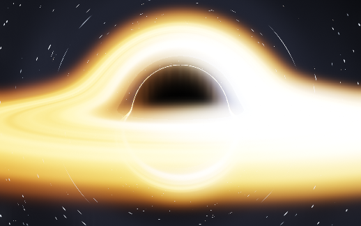

# Black hole — every pixel a photon orbit 🕳️

A real-time Schwarzschild black hole in **one HTML file — no libraries, no
assets, no network**. Pure WebGL2: each pixel integrates the path of a photon
through curved spacetime until it either falls through the event horizon or
escapes to a procedurally generated sky.

**▶ Live demo: https://vesanieminen.github.io/Local-AI-slop/examples/blackhole/**



## What you're looking at

- **The shadow** — the 2.6 `rs`-wide silhouette where photon orbits terminate at
  the horizon. Not the horizon itself: light bends, so the shadow is bigger
  than the hole.
- **The accretion disk** — a thin Keplerian disk sampled exactly where each
  photon's path crosses the equatorial plane. Filaments and swirl from
  domain-warped value noise, with `omega ∝ r^-1.5` differential rotation.
- **The arc over (and under) the hole** — the far side of the disk, its light
  bent around the black hole, classic *Interstellar* / EHT style.
- **The hot spot on one side** — relativistic Doppler beaming: material moving
  toward you gets boosted by the relativistic `g³` factor (plus gravitational
  redshift), the receding side dims and reddens.
- **The photon ring** — a thin bright rim at the shadow edge from photons that
  wound around the photon sphere one or more times before escaping.
- **The lensed starfield** — a seam-free 3D-cell star field plus a faint galactic
  band, sampled along the *final bent direction* of every escaping ray, so the
  whole sky warps around the hole.

## The physics (honest version)

Schwarzschild metric, units where the Schwarzschild radius `rs = 1`. A photon's
specific angular momentum `h` is conserved, and the null-geodesic orbit equation
`u'' + u = 3M·u²` rearranges into a central-force form that can be marched
directly:

```
d²r⃗/dt² = −(3/2)·rs·h²·r⃗ / |r⃗|⁵
```

Per pixel: RK2 (midpoint) integration with step size `dt ≈ 0.006·r²` (fine near
the photon sphere at `1.5 rs`, coarse in flat space), up to a few hundred steps.
If `|r| < 1` the ray is eaten; the disk is sampled at every equatorial crossing,
composited front-to-back. Doppler factor: disk material orbits at the local
circular velocity `v = √(M/(r−2M))`, and each crossing is boosted by
`g = 1/(γ(1 − v⃗·n̂)) · √(1−rs/r)`, with intensity `∝ g³` and a matching
hue shift. It's a thin-disk toy — not a general relativistic radiation
transfer code — but the bending, the shadow, the beaming asymmetry and the ring
are real geodesic behavior, not faked with screen-space tricks.

## Controls

- **drag** to orbit (there's a slow idle drift, Interstellar-style), **wheel /
  pinch** to zoom
- **lensing** slider → set it to 0 and the metric flattens: no shadow, no arcs,
  just a boring flat-spacetime disk. Everything else stays put — the difference
  is pure GR.
- **doppler beaming** → 0 makes the disk symmetric; 2 makes the approaching
  side savage
- **disk density**, **exposure**
- Presets: `Interstellar`, `Edge-on`, `Face-on`, `Photon ring`
- `♪ music` — generative ambient: detuned drone stack under an LFO-swept
  lowpass, filtered noise "solar wind", and random FM bell pings through a
  feedback delay. Synthesized live, not a file.
- `h` hides the chrome, `f` fullscreen
- Resolution auto-scales to hold ~60 fps; the HUD reports fps, render scale and
  photon-step count.

## How it was checked

Verified headless (Playwright + Chromium/SwiftShader) with a pixel-measurement
harness, not vibes — `readPixels` stats per screen region:

- zero page/console errors; all five shader programs compile and link
- the shadow region is black while the arc region directly above it is bright
  (that arc only exists because light bends)
- turning lensing off drops the arc's brightness to sky level — A/B proof of
  the geodesic integration
- the two sides of the disk differ by a large brightness ratio (Doppler
  beaming), and it vanishes when the Doppler slider goes to 0
- face-on vs edge-on vs Interstellar presets produce measurably different
  images; drag-orbit and audio-graph checks pass

## Run it locally

Just open `index.html`. Unlike the other examples it doesn't even need a CDN —
it runs on a plane.

```bash
python3 -m http.server 8000   # or just double-click the file
```

## Credits / legal

Physics follows the standard Schwarzschild null-geodesic treatment (the orbit
equation is a century old; the per-pixel Cartesian marching form popularized by
Garg & Kar and Shadertoy implementations). Star field, disk noise, shaders,
music: generated in-file by an AI agent on a Saturday evening. No photons were
harmed; several were absorbed.
