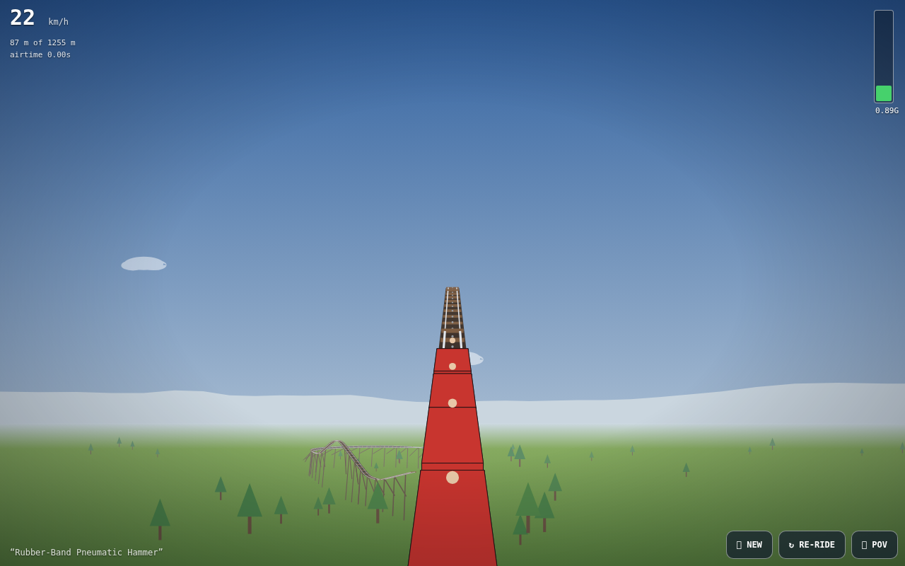

# RollerCoaster — Scream Machine Edition 🎢

A theme-park engineer's daydream: the coaster designs itself, a physics engine
decides whether it works, and then you ride it from the front seat while the
wood clanks and the wind roars. **One HTML file — no libraries, no assets, no
network.**

**▶ Live demo: https://vesanieminen.github.io/Local-AI-slop/examples/coaster/**

## How a coaster gets built

Design happens in score, not geometry: a grammar lays down **grade and heading
profiles per metre** — station, chain lift, first drop, camelback airtime hills,
banked turns, a helix, brake run — each piece cos-eased into the next. The
centreline is then integrated at 0.35 m steps.

Before you ever see it, a **design simulation** rides the prototype: energy
budget (`½v² = g·Δh − losses`), airtime check on every crest (parabola hang
time vs. clearance), max-G scan, terrain-clearance probe. A layout that stalls,
floats you out of your seat by 4 G, or tunnels through a hill is thrown out and
re-rolled, up to 26 attempts per seed. Survivors get **RCT-flavoured ratings**
— Excitement, Intensity, Nervousness — and a name like *Rubber-Band Pneumatic
Hammer*.

## The ride

- **Physics:** 240 Hz point-mass on the spline — gravity along the grade,
  friction `0.004v + 0.00035v²`, chain speed, magnetic brakes. The G-forces in
  the corner meter are measured **in the seat** (centripetal `v²·κ` plus the
  tangent term), not faked. Zero-G stretches flash the airtime counter.
- **Rendering:** hand-rolled perspective projection on a plain 2D canvas —
  Liang-Barsky frustum clipping, distance fog, wood trestles with ties, posts
  and knee braces, chain links crawling up the lift, station roofs, birch and
  pine, mountain silhouettes, drifting clouds. Depth-sorted 20 m chunks,
  far-to-near.
- **Sound:** everything synthesised in Web Audio — the chain clank (noise
  bursts on a fixed pitch), wheel rumble that tracks speed, wind that rises
  with it, real screams on airtime moments (formant oscillators with vibrato),
  and the arrival bell.
- **Cameras:** front-seat POV with the car nose in frame, or a chase cam that
  lets you watch your own five-car train rattle through the layout.

## Tweak it from the URL

`?seed=NAME` pins a coaster (share your build), `?cam=chase` opens in chase
view. Built-in adaptive quality watches frame time and shrinks the render
scale if a device struggles — the software-rendered CI screenshots here
undersell it; on any real GPU it's a flat 60.

## Runs on mobile

Full-viewport canvas, touch-action locked, safe-area-aware buttons, tap-to-start
audio unlock. Tested at 390×844 touch and 1280×800 desktop.
