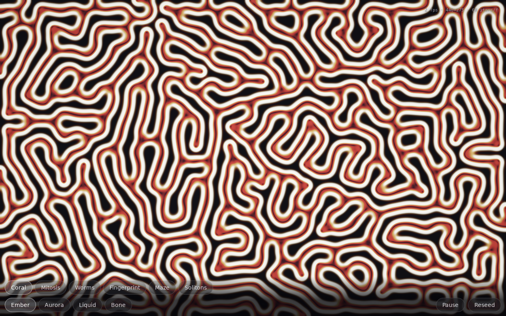

# Coral — reaction-diffusion life 🪸

Two virtual chemicals diffuse across a GPU texture and react, and out of four
lines of math grow coral filaments, dividing cells, worms, fingerprints and
mazes. **One HTML file — no libraries, no assets, no network.**

**▶ Live demo: https://vesanieminen.github.io/Local-AI-slop/examples/coral/**



## The math

Gray-Scott system, integrated per texel with explicit Euler on two ping-ponged
RGBA16F textures:

```
A' = A + (D_A·∇²A − A·B² + f·(1−A))·dt
B' = B + (D_B·∇²B + A·B² − (f+k)·B)·dt
```

A is fed from the environment at rate `f`, B is killed at rate `k`, and — the
part that makes patterns possible — **B diffuses half as fast as A** (the
Turing instability; equal rates give you only smooth soup). Each preset chip
is a point on the (f, k) regime map:

| Preset | f | k | Grows |
|---|---|---|---|
| Coral | 0.0545 | 0.0620 | branching, calcifying fingers |
| Mitosis | 0.0367 | 0.0649 | cells that pinch and divide forever |
| Worms | 0.0540 | 0.0630 | wandering tentacles |
| Fingerprint | 0.0370 | 0.0619 | whorls and ridge lines |
| Maze | 0.0290 | 0.0570 | self-optimizing labyrinth walls |
| Solitons | 0.0300 | 0.0620 | stable pulsing spots |

## How it's put together

- **Simulation:** 9-point star Laplacian, one texture swap per step, 16–110
  steps per frame. The sim texture is only ~640 texels across — the pattern
  is upscaled smoothly, which is why it flies even on phones.
- **Adaptive quality:** frame-time average drives the step count up/down, so
  the loop finds 60 fps on its own. A dead field is detected with a cheap
  readback probe and reseeded automatically.
- **You are the brush:** dragging paints chemical B (multi-touch aware) —
  every stroke is injected inside the step shader, zero extra passes.
- **Look:** the draw pass shades |∇B| through a four-stop gradient, so the
  tissue is dark and the edges glow; four palettes, filmic rolloff, vignette.

Tweak quality from the URL: `?long=NNN` (sim size) and `?steps=NNN` (pinned
iterations/frame) — handy on a laptop GPU where the software-rendered CI
screenshots undersell what the shader actually does.

## Runs on mobile

Full-viewport canvas, touch-action locked, safe-area-aware control bar with
scrollable chip rows, coarse-pointer devices get a smaller sim from the start.
Tested at 390×844 touch and 1280×800 desktop.
