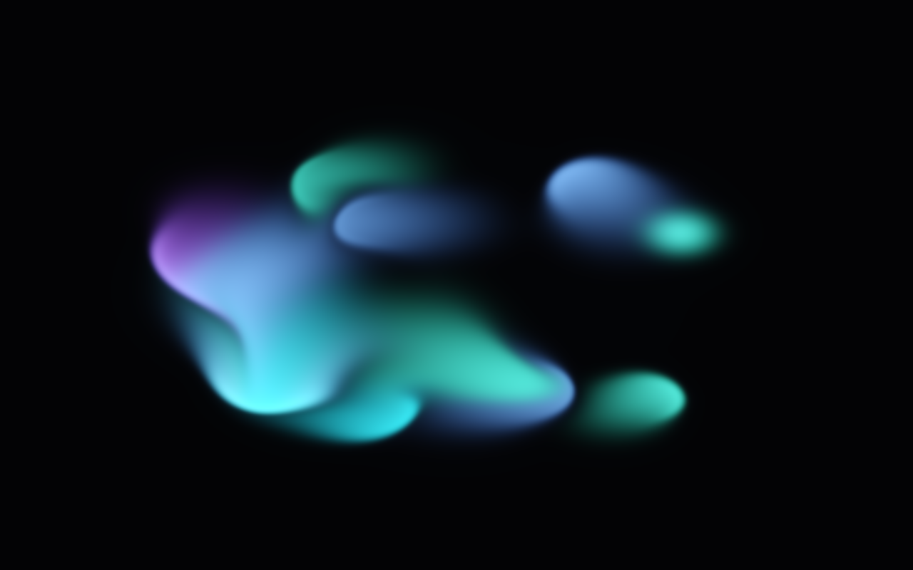

# Ink — a fluid you can stir 🌀

A real-time incompressible fluid in **one HTML file — no libraries, no assets,
no network**. Drag across the canvas to pour glowing ink into a swirling vortex;
the ink advects, folds and fades on its own. Four palettes, a stir button, and
a pause.

**▶ Live demo: https://vesanieminen.github.io/Local-AI-slop/examples/ink/**

## The physics

Classic stable fluids, all on the GPU in half-float textures:

1. **Advect** the velocity field through itself (semi-Lagrangian back-trace).
2. **Divergence** — `∇·v` from the four neighbours.
3. **Pressure** — solve `∇²p = ∇·v` with a short Jacobi iteration.
4. **Project** — subtract `∇p`, so the velocity field is incompressible.
5. **Advect the dye** through the projected velocity.

That's it. No particles, no meshes — the ink is just a scalar/colour field being
carried by a velocity field. Splats add momentum and dye at the pointer; a slow
autonomous pulse keeps the soup alive when nobody is touching it.

## How it's put together

- **Simulation:** velocity (RG), dye (RGB), divergence and pressure in
  `RGBA16F` textures, double-buffered. Pressure Jacobi runs 10–24 iterations
  depending on measured frame time.
- **Look:** the draw pass tone-maps the dye, adds a cheap neighbour-ring bloom,
  and crushes the faint haze so filaments stay bright against the deep-water
  background. Film rolloff keeps the hues instead of blowing everything white.
- **Interaction:** pointer drags emit a chain of splats along the stroke;
  multi-touch works, and momentum is injected in the drag direction. The
  **Stir** button drops a ring of inward/tangential impulses, **Clear** wipes the
  field, **Pause** freezes physics while the last frame stays on screen.
- **Adaptive quality:** sim resolution is 512 texels on desktop, 288 on coarse
  pointers, and pressure iterations scale down when frames get slow.

Tune it from the URL: `?sim=NNN` (simulation long side), `?seed=NNN` (seeded
splats), `?warm=NNN` (pre-run N physics steps) — handy for deterministic
screenshots on software GL.

## Runs on mobile

Full-viewport canvas, `touch-action: none`, safe-area-aware bottom bar with
scrollable palette chips, coarse-pointer devices start at a smaller sim.
Tested at 390×844 touch and 1280×800 desktop.
