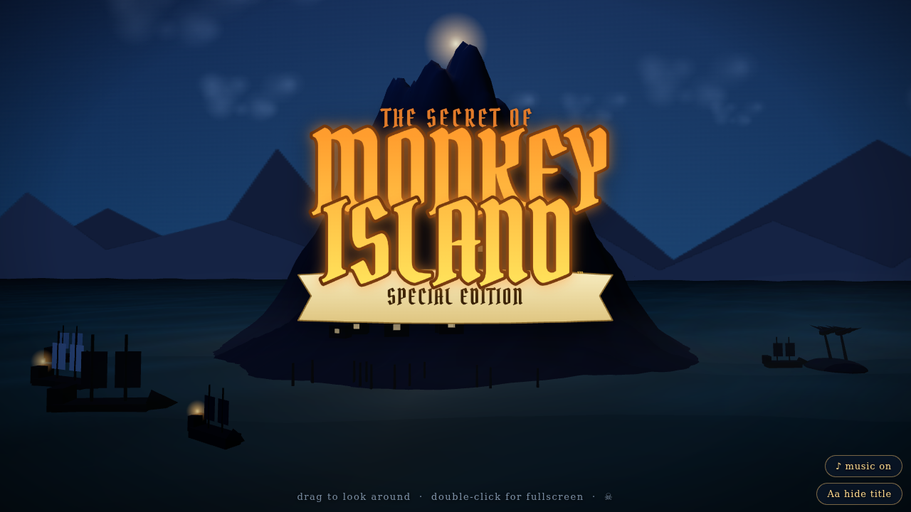

# The Secret of Monkey Island — 3D intro 🏴‍☠️

The opening of Monkey Island Special Edition rebuilt as a live 3D scene in
**one HTML file**: moonlit Melee-style island, lantern-lit sloops, volumetric-ish
sea, a starfield, and the glowing title logo — while the “Main Title Theme”
plays back note-for-note through Web Audio FM synthesis (the whole score is
encoded inline as event data; no audio files).

**▶ Live demo: https://vesanieminen.github.io/Local-AI-slop/examples/monkeyisland/**

## What it does

- **Click to start** — browsers require a gesture before audio can play, and
  the scene stays frozen until then, exactly like the original's title card.
- Once started: the logo breathes and pulses with the music's beat phase, the
  sea animates, and you can **drag to orbit**, double-click (or pinch) for
  fullscreen. Music and title are toggleable buttons.
- The logo is drawn procedurally on a 2D canvas in the Pirata One display font
  and mapped into the DOM over the WebGL scene.

## Stack

- three.js r160 (the only external — CDN module import, same as the OutRun
  example) + Google Fonts. Everything else, including the entire soundtrack,
  lives in the one file.
- WebGL, no assets, no build step; `touch-action` locked and viewport meta for
  phones; falls back to a readable message if WebGL or the CDN fails.

## Ported from

Originally developed in a separate scratch folder (`visual-test`); brought
here with two mobile fixes: a `<meta viewport>` tag and `touch-action: none`
on the canvas. Everything else is byte-identical.
