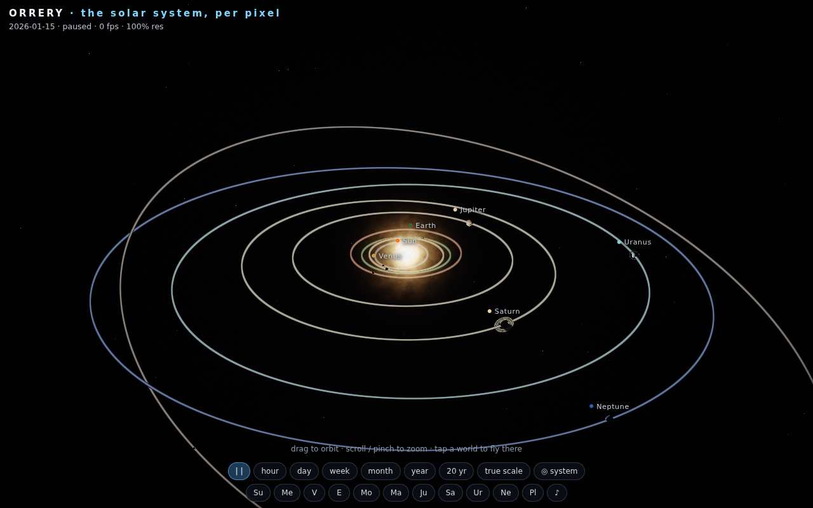

# Orrery — the whole solar system, pixel by pixel 🪐

The solar system as **one HTML file — no libraries, no assets, no network**.
Every pixel is raytraced in a single WebGL2 fragment shader: the Sun and eleven
worlds are analytic spheres, their orbits are real Keplerian ellipses, and every
surface — Jupiter's storms, Earth's oceans and night lights, the rings of
Saturn — is procedural noise evaluated in the shader.

**▶ Live demo: https://vesanieminen.github.io/Local-AI-slop/examples/orrery/**

## What you're looking at

- **Real orbits, not animated circles** — each world's position comes from its
  J2000 mean orbital elements (a, e, i, Ω, ω, M₀) with Kepler's equation solved
  by Newton iteration every frame. Eccentricities, inclinations and periods are
  the actual numbers, so Pluto's tilted egg-shaped orbit, the seasons' pace and
  the moon's month are all just *what the elements say*.
- **Two scales, one toggle** — orbits compressed (`a^0.55`) so it's playable, or
  **true scale** so it's humbling: at real proportions the planets are specks and
  the system is mostly void.
- **Time warp** — an hour to twenty years per second, live date readout. Watch
  Jupiter lap the inner worlds, or pause at an afternoon.
- **Procedural worlds** — gas giants from domain-warped latitude bands (with the
  Great Red Spot and a dark spot on Neptune), Earth with fbm continents, drifting
  cloud deck, ocean glint, polar ice and city lights on the night side, rocky
  worlds cratered by cell noise with icy polar caps.
- **Rings that cast and catch shadows** — Saturn's ring band is a density profile
  with Cassini-style gaps; the planet's shadow falls across the rings (with a
  penumbra), and the rings' shadow falls back onto the planet. Uranus rolls on
  its side with its own faint vertical rings.
- **The Sun is an actual light source** — granulating photosphere, corona noise,
  day/night terminators, ocean specular aimed at it, and an eclipse: when a world
  crosses in front, the corona occludes.
- **A hashed starfield with a Milky Way band**, anti-aliased orbit rings, ACES
  tone mapping, dithering.

## Controls

- **drag** to orbit, **scroll / pinch** to zoom
- **tap a world** (or its label, or the chips) to fly there — the camera swings
  around to the sun-lit side as it arrives
- **speed chips** from paused to 20 years/sec, **true scale** toggle,
  **◎ system** for the wide view
- **♪** — ambient space drone plus a "music of the spheres" chime on every world
  you select (one note each, because of course)

## Implementation notes

One fullscreen triangle, one fragment shader. Body positions, spin angles,
orbit ellipse bases and radii are computed in JS (Kepler solver, display-space
compression) and uploaded as uniform arrays; the shader does analytic
ray/sphere and ray/ring-plane intersections, isocontour orbit rings with
`fwidth` anti-aliasing, and shading. Adaptive quality: measured frame time
drives render resolution (down to 50 %) and noise octaves, so phones hold 60 fps.

URL hooks for testing/screenshots: `?date=2026-01-15` `?speed=0` `?view=saturn`
`?mode=true` `?q=1..3` (octaves) `?rs=1` (lock resolution) `?dbg=1|2|4|8`
(hide lines/stars/galaxy/corona), state readable at `window.__perf`.
