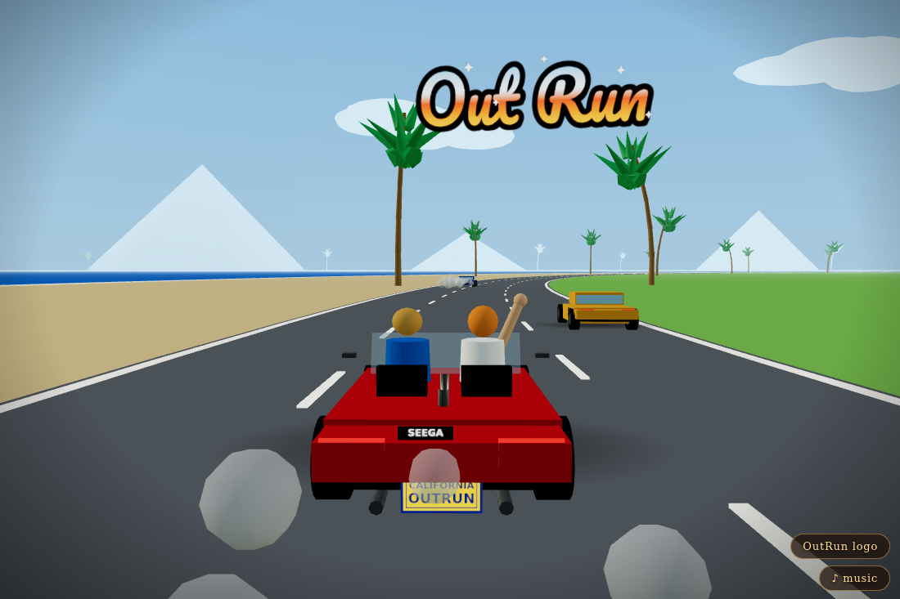

# OutRun — 3D 🏝️🚗💨

A single-file browser recreation of the classic *OutRun* (SEGA, 1986) arcade poster
as an animated Three.js scene, with the actual arcade soundtrack — **no assets, no
build step, one HTML file**.

**▶ Live demo: https://vesanieminen.github.io/Local-AI-slop/examples/outrun/**



## What's in the scene

- Red Testarossa-style convertible from behind — `SEEGA` badge, yellow/blue
  `CALIFORNIA · OUTRUN` plate, twin exhausts, side strakes, spinning wheels
- A driver and a passenger who waves at you
- The blue and yellow rivals, drifting ahead as you chase the horizon
- Cotton-ball exhaust smoke, left behind in world space
- An endless curved coastal highway: sand + ocean + distant shore on the left,
  palms and green fields on the right
- The `Out Run` script logo, gradient-sunset-filled, floating in the sky
- A cinematic intro camera swing, then a poster-framed chase cam — **drag to look around**

## The music

“Splash Wave” played **note-for-note from the arcade FM music data**
(`OutRnJ-BGM3.mid`, 150 BPM): 5,159 quantized events synthesized live with the
Web Audio API — FM bell lead with slapback echo, FM bass, chord stabs, and
synthesized kick/snare/hats. Looping.

Toggle with the `♪ music` button; `OutRun logo` toggles the sky sign.

## How it was checked

The visuals and the music were verified programmatically, not vibed:

- Rendered headless (Playwright + WebGL): zero console errors; the red car, both
  rivals, the logo, and the hero all confirmed on-screen at multiple timestamps;
  world motion confirmed by coordinate diffs.
- The song engine was rendered offline (deterministic, same code as live playback)
  and analyzed with independent pitch detection:
  - lead melody: **121/121** notes at correct pitch (±0.6 semitone)
  - bass: **84/84** · stabs: **28/28** (energy at exact expected frequencies)
  - drums: **148/150** hits on the 16th-grid
  - embedded note data byte-identical to a fresh extraction of the arcade MIDI

These checks caught real bugs: silent drums (undefined velocities), a bass
sub-oscillator an octave below the source, and rival cars with no wheels.

## Run it locally

Just open `index.html` in a browser. It pulls `three` from unpkg and *Pacifico*
from Google Fonts — everything else is inline.

```bash
python3 -m http.server 8000   # or just double-click the file
```

## Credits / legal

Fan homage. *OutRun* and its music are SEGA's; the MIDI note data embedded here
comes from the arcade game's music (extracted from a community rip of
`OutRnJ-BGM3.mid`). `SEEGA` is an intentional poster-ism, not a typo. Made by an
AI agent on a Wednesday evening. Absolutely no cars were harmed.
