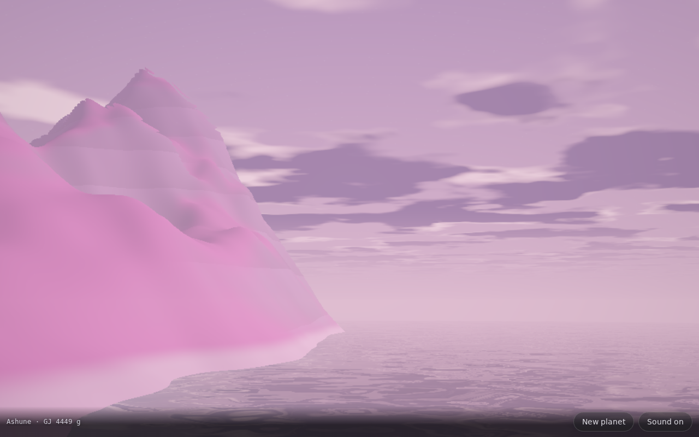

# Planetwalk — a new alien planet every tap 🪐

An infinite alien planet you can walk on, raymarched per pixel — and every
seed is a whole new world: terrain, palettes, sea level, snowline, sun, moons,
clouds, wind, **and a name**. **One HTML file — no libraries, no assets, no
network.**

**▶ Live demo: https://vesanieminen.github.io/Local-AI-slop/examples/planetwalk/**

## What makes a planet

One integer seed feeds everything:

- **Terrain** — domain-warped fBm continents plus masked ridged fBm mountains
  (`pow(1−2|fBm|, 1.7)`), rolling hills and a fine ground-detail octave.
- **Biome** — six palette families (Rust, Jade, Frost, Ash, Bloom, Glass),
  each jittered per planet; sea level, snowline, cloud deck, fog density and
  sun elevation are all rolled from the seed.
- **Sky** — sun disc + glow, up to two cratered moons (one can be ringed),
  twinkling stars when the sun is low, and one scrolling fBm cloud layer with
  poor-man's self-shadowing.
- **A name** — generated syllables plus a real star catalogue: *Voridor Minor
  · WASP 3437 g*. Same seed, same name, forever. Share the URL.

## How the rendering works

- **The ground is a function, not a mesh.** `H(x,z)` is evaluated inside a
  fragment shader and the ray marches with conservative steps
  (`dt ≥ (y−H)/3.7`, valid while `|∇H| ≲ 2.6`); surface crossings get seven
  bisection iterations. No geometry, no LODs — the detail octave is blended
  out by distance instead of switched, so silhouettes never pop.
- **Water is exact**: the sea is an analytic plane, so it intersects the ray
  in closed form — animated ripple normals from a scrolling fBm, Fresnel
  blend into the *same* procedural sky (moons reflect in the sea), depth
  tinting from the sampled seabed, shore foam. Distance fades the ripples so
  the far sea becomes a clean mirror.
- **The CPU knows the ground too.** Walking physics runs the *same* noise in
  JS: an integer hash with exact mod-2^32 semantics (`Math.imul` ↔ GLSL
  `uint`) and identical octaves, so your feet find the GPU's surface. Jump,
  footstep bob, wading and splash triggers all come from that twin.
- **Adaptive quality:** the render scale steps up/down a fixed ladder by
  frame-time average (debounced 600 ms, quantized so buffers aren't
  reallocated every frame). Phones start at 0.55× and find 60 fps on their own.

## Sound

All synthesized: wind (filtered noise with a slow LFO, louder when you run or
climb), footsteps and landing thuds, splashes when you wade in, and a swept
warp whoosh when you jump to a new planet.

## Controls

| | Walk | Look | Jump | New planet |
|---|---|---|---|---|
| Desktop | WASD / arrows (Shift run) | drag mouse | Space | `R` or the button |
| Phone | left-stick (bottom-left) | drag elsewhere | — | the button |

## URL knobs

`?seed=NNNN` pins a planet (the URL updates itself when you switch),
`?t=seconds` freezes the animation clock, `?px=` pins the render scale and
`?steps=` pins the march budget — handy for headless screenshots on software
GL, where a 1280×800 frame of this shader costs a few minutes.

## Runs on mobile

Full-viewport canvas, `touch-action: none`, safe-area-aware bar, touch stick +
drag look, coarse-pointer devices get a smaller starting scale. Tested at
390×844 touch and 1280×800 desktop.
